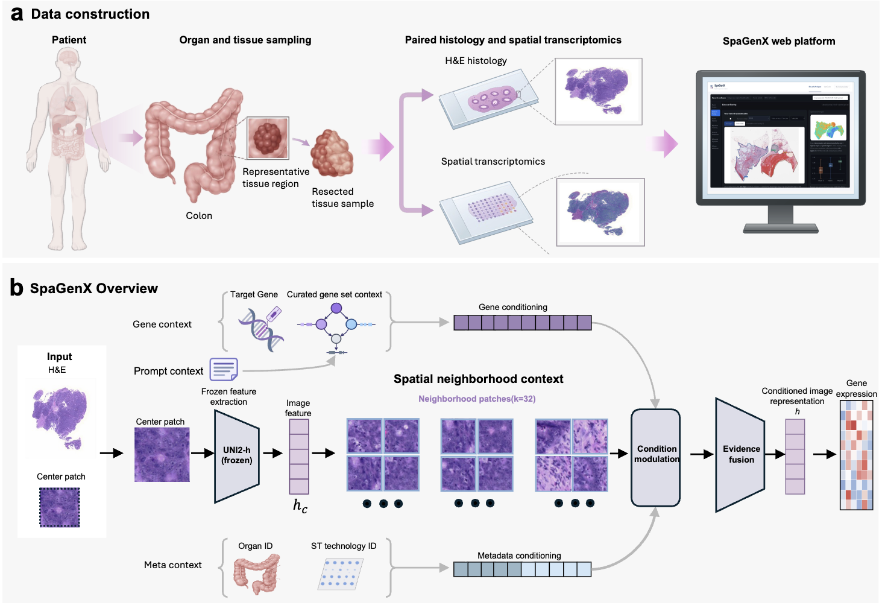

# SpaGenX

## Spatial gene expression prediction from histology with structured spatial context



SpaGenX is a histology-based framework for inferring spatial gene expression from routine H&E slides and enabling downstream analyses of molecular phenotypes, spatial expression patterns, and patient outcomes.

[中文说明](README.zh-CN.md) · [完整PyTorch命令教程](docs/USAGE.zh-CN.md) · [Data contracts](docs/DATA_CONTRACT.md)

## System requirements

The code was validated on Linux with Python 3.9, PyTorch 2.6.0, NumPy 1.26.4, SciPy 1.13.1, pandas 2.1.4 and timm 0.9.16. GPU workflows need a compatible NVIDIA driver and CUDA-enabled PyTorch. OpenSlide and its native library are required for supported whole-slide image formats.

The training configuration uses four GPUs, per-GPU batch 64 and BF16. Inference loads UNI2-h and SpaGenX sequentially; SpaGenX defaults to FP32, patch batch 16 and gene chunk 256. GPU execution is recommended for WSI feature extraction and inference. See the recorded [validation environment](docs/validation.json).

## Installation

Run commands from the repository root.

```bash
git clone https://github.com/JMJ-rbgss/SpaGenX.git
cd SpaGenX

conda create -n spagenx python=3.9 -y
conda activate spagenx
python -m pip install torch==2.6.0 torchvision==0.21.0 \
  --index-url https://download.pytorch.org/whl/cu118
python -m pip install -r requirements.txt
python -m pip install anndata==0.10.8 Pillow==11.3.0
```

This selects the CUDA 11.8 PyTorch build. For CPU-only use, select the CPU index instead. Choose a driver-compatible build using the [official PyTorch instructions](https://pytorch.org/get-started/previous-versions/).

OpenSlide needs both its Python binding and native library. Follow its [platform installation instructions](https://openslide.org/api/python/); on supported platforms the native library can be supplied with:

```bash
python -m pip install openslide-bin
python -m pip check
python -c "import torch, timm, openslide; print(torch.__version__, torch.cuda.is_available())"
```

Prepare the external weights and metadata described in [Data & model availability](#data--model-availability).

## Repository structure

```text
preprocessing/       Features, measured expression, rowmap and typed neighborhoods
                     Canonical gene/Program correction and active-row HVG384
training/            Native model, recovery trainer and configuration launcher
inference/           Frozen-feature and WSI inference implementation
scripts/             Automatic WSI preprocessing/inference orchestration
configs/             External-asset, preprocessing and training examples
tests/               Synthetic, boundary and automation tests
assets/              SpaGenX overview figure
docs/                Usage tutorial, data contracts, provenance and validation
external_assets/     User-provided weights/metadata; ignored by Git
runs/                Local outputs; ignored by Git
requirements.txt     Python dependencies
```

Keep real images, expression matrices, patient identifiers, features and checkpoints outside version control.

## Usage

Two workflows are provided: frozen inference for a new WSI, and research preprocessing/training with paired histology and expression data. Commands below use Bash. Replace `/external/...` with real local paths and choose new output directories.

### 1. Predict expression from a new WSI

#### 1. Prepare the frozen assets

Use this local layout or configure absolute paths:

```text
external_assets/
├── SpaGenX_weights.pt
├── uni2h/pytorch_model.bin
├── gene_to_program_m16_overlay.pt
├── global_gene_vocab.tsv
└── codebooks.json
```

```bash
cp configs/bundle.example.json bundle_config.json
```

Edit asset paths in `bundle_config.json`. Keep the supplied model/preprocessing implementations and verify asset hashes against [external_assets.json](docs/external_assets.json).

Obtain UNI2-h from its [official model page](https://huggingface.co/MahmoodLab/UNI2-h). Request SpaGenX assets from the maintainers; download links will be added here.

#### 2. Select the organ and genes

Provide one unambiguous canonical gene symbol or global ID per line, without a header:

```text
VIM
COL1A1
CD74
```

Save it as `/external/query_genes.txt`. Duplicate and ambiguous queries are rejected. Select one of the 17 organs in `codebooks.json` and pass it with `--organ`; `Breast` is used below.

#### 3. Extract features and construct neighborhoods

```bash
CUDA_VISIBLE_DEVICES=4 python inference/spagenx_cli.py --bundle . preprocess \
  --image /external/slides/example.svs \
  --out runs/example_001/preprocessed \
  --device cuda:0
```

If reliable MPP metadata are missing, provide `--mpp` with the true input resolution. Use `--mpp 0.5` only when that value is known. Physical GPU 4 becomes `cuda:0` inside a process selected by `CUDA_VISIBLE_DEVICES=4`.

The application pipeline uses a non-overlapping 224×224 grid at 0.5µm/px, background filtering with grayscale threshold 205/white fraction 0.8, frozen 1536-dimensional UNI2-h features and candidate32/homo12/hetero8 neighborhoods. The maximum number of accepted patches is 16,000; larger inputs stop with an error.

WSI inference uses grid sampling and normalized slide-local distances. Paired spatial experiments use spot-based sampling and the stored training-overlay distance units.

#### 4. Predict expression

```bash
CUDA_VISIBLE_DEVICES=4 python inference/spagenx_cli.py --bundle . infer \
  --features runs/example_001/preprocessed/features.pt \
  --neighbors runs/example_001/preprocessed/neighbors.pt \
  --genes-file /external/query_genes.txt --organ Breast \
  --out runs/example_001/predictions \
  --patch-batch 16 --gene-chunk 256 --device cuda:0
```

Inference uses the SpaGenX weight configuration, with gene bias enabled, tech_zero and no expression prompt. Gene chunking partitions computation across all requested genes. Trusted existing features and matching neighborhoods can be used directly.

#### 5. Automatic two-stage execution

```bash
export CUDA_VISIBLE_DEVICES=4
export WSI=/external/slides/example.svs
export ORGAN=Breast
export GENES_FILE=/external/query_genes.txt
export RUN_DIR=/external/spagenx_runs/example_002
export DEVICE=cuda:0

# Set only if the true source MPP is known and an override is needed:
# export MPP=0.5

bash scripts/infer_wsi.sh --dry-run
bash scripts/infer_wsi.sh --execute
```

The default is preview-only. `--execute` connects preprocessing and prediction, with separate logs. `RUN_DIR` must be a new absolute path. A failed preprocessing stage prevents prediction.

### 2. Prepare paired research data and train SpaGenX

#### 1. Prepare data and configuration

Research preprocessing requires paired images, measured expression, exact spot identities/coordinates, organ/technology metadata and verified splits. Preserve measured zeros and distinguish them from unmeasured genes. Keep canonical gene IDs, Program mappings and codebooks aligned.

```bash
cp configs/preprocessing.example.json configs/preprocessing.local.json
```

Edit each stage's input/output paths, including paths embedded inside manifests. See [DATA_CONTRACT.md](docs/DATA_CONTRACT.md) for required data schemas.

#### 2. Construct features, expression and spatial assets

Preview each required stage:

```bash
python preprocessing/run.py --stage discover --config configs/preprocessing.local.json
python preprocessing/run.py --stage features --config configs/preprocessing.local.json
python preprocessing/run.py --stage merge --config configs/preprocessing.local.json
python preprocessing/run.py --stage expression --config configs/preprocessing.local.json
python preprocessing/run.py --stage rowmap --config configs/preprocessing.local.json
python preprocessing/run.py --stage neighbors --config configs/preprocessing.local.json
python preprocessing/run.py --stage canonical --config configs/preprocessing.local.json
python preprocessing/run.py --stage hvg384 --config configs/preprocessing.local.json
```

Add `--execute` to an individual command after checking prerequisites and fresh outputs. Inspect its result and configure later inputs explicitly. Canonical correction requires manifests, rowmap and source Program tables; active-row HVG384 rebuilding requires corrected chunks, rowmap and frozen splits.

Historical 17-organ extension and older HVG migration scripts are protected source archives. They originally used in-place migrations; do not remove their guards or run them on source data.

#### 3. Launch native training with PyTorch

```bash
cp configs/train.example.json configs/train.local.json

# Preview the distributed command:
python training/run.py --config configs/train.local.json

# Start only after validating assets, GPUs and a fresh output path:
python training/run.py --config configs/train.local.json --execute
```

The launcher uses `python -m torch.distributed.run`, one process per configured GPU. The original contract uses four GPUs, per-GPU batch 64, BF16, AdamW with learning rate/weight decay 1e-4, gradient clip 1.0, gene chunk 2048 and seed 42. Native training prompt/gene-bias scheduling starts at step 5000.

The default configuration starts at step 0 with seed-42 random initialization; it does not load a checkpoint. To resume an interrupted run, copy `configs/train.resume.example.json`, set the full-state checkpoint path and its saved step, and choose a fresh output directory. Full-state resume uses checkpoints written by this training entry point with the same GPU count.

A full four-GPU `torchrun` template is in the [training tutorial](docs/USAGE.zh-CN.md#7-pytorch四卡训练). Native commands start training immediately; the configuration wrapper previews commands by default. Validation follows the metric implemented in the native trainer.

## Output naming

Automatic WSI inference writes:

```text
<RUN_DIR>/
├── preprocess.log
├── inference.log
├── preprocessed/
│   ├── features.pt
│   ├── neighbors.pt
│   ├── patches.tsv
│   └── preprocess.json
└── predictions/
    ├── predictions.npz
    └── inference.json
```

`predictions.npz` stores `pred_log1p` (patch×query-gene), `global_gene_ids`, `gene_symbols`, `coords_level0_center` and `patch_ids`:

```python
import numpy as np

with np.load('/external/spagenx_runs/example_002/predictions/predictions.npz',
             allow_pickle=False) as result:
    expression = result['pred_log1p']
    genes = result['gene_symbols']
    coordinates = result['coords_level0_center']
    print(expression.shape, genes.tolist(), coordinates.shape)
```

The expression matrix uses the log1p raw-count scale. `inference.json` records model identity, forward protocol, input hashes and computational settings.

Training can save `last_checkpoint.pt`, `last_full_state_checkpoint.pt`, `best_per_gene_pcc_checkpoint.pt` and evaluation tables, depending on options. Full-state and inference-only checkpoints have different purposes.

## Validation and troubleshooting

```bash
python tests/test_release.py
python tests/test_automation.py
python inference/spagenx_cli.py --help
python preprocessing/run.py --help
python training/run.py --help
```

Tests cover synthetic identity/mask handling, measured zeros, neighborhood padding, preprocessing boundaries and preview safety. [Packaging validation](docs/validation.json) records model-equivalence checks performed with private test assets.

For missing MPP, ambiguous genes, feature/neighbor mismatch, checkpoint errors or OOM, use the [troubleshooting table](docs/USAGE.zh-CN.md#9-常见问题). Load `.pt` inputs only from trusted sources.

## Data & model availability

The repository provides code and the overview figure. Request SpaGenX weights, gene dictionaries and Program mappings from the maintainers; download links will be added here. Keep research data and runtime assets outside Git.

UNI2-h is an external frozen encoder with its own access and license conditions.

## Citation

Citation information will be added with the publication.

## License

The owner must confirm the code license and third-party publication eligibility before public release. Dependency terms and UNI2-h access conditions remain applicable; see [THIRD_PARTY_NOTICES.md](docs/THIRD_PARTY_NOTICES.md).
