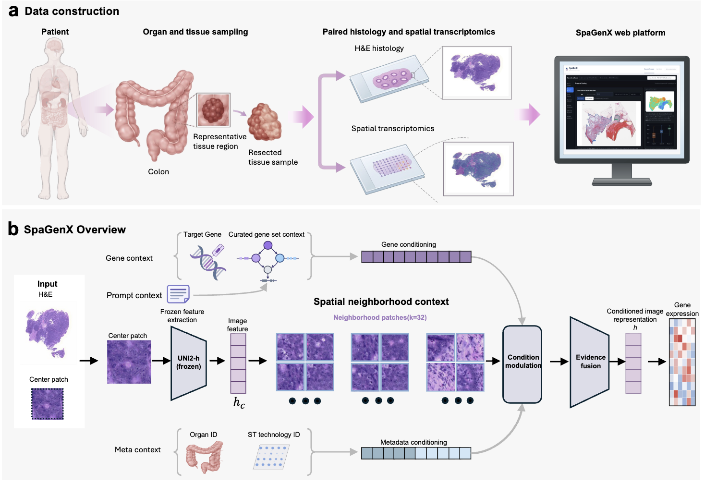

# SpaGenX

## 基于组织学图像与结构化空间上下文预测空间基因表达



SpaGenX使用冻结UNI2-h图像表示，结合目标基因、整理后的基因集上下文、器官/技术元数据以及candidate、homo、hetero空间邻域预测基因表达。仓库提供数据预处理、原生训练与冻结推理实现。

当前推理使用step42000的正式权重，禁用表达prompt并开启gene bias。图示中的prompt通路不表示推理需要真实表达。

[English README](README.md) · [完整PyTorch命令教程](docs/USAGE.zh-CN.md) · [数据合同](docs/DATA_CONTRACT.md)

## 系统要求

验收环境为Linux、Python3.9、PyTorch2.6.0、NumPy1.26.4、SciPy1.13.1、pandas2.1.4及timm0.9.16。WSI需要OpenSlide及底层动态库。原训练合同为四卡、每卡batch64和BF16；SpaGenX推理默认FP32、patch batch16、gene chunk256。

## 安装

私有仓库需要已授权账号。以下命令从仓库根目录执行：

```bash
git clone https://github.com/JMJ-rbgss/SpaGenX.git
cd SpaGenX
conda create -n spagenx python=3.9 -y
conda activate spagenx
python -m pip install torch==2.6.0 torchvision==0.21.0 \
  --index-url https://download.pytorch.org/whl/cu118
python -m pip install -r requirements.txt
python -m pip install anndata==0.10.8 Pillow==11.3.0
```

OpenSlide需同时安装Python绑定和底层库，适用平台可使用`python -m pip install openslide-bin`。CPU环境需选择PyTorch CPU构建，不能把CUDA依赖当作所有平台通用配置。权重、词典和真实数据不自动下载。

## 目录结构

```text
preprocessing/       特征、表达、rowmap、邻域、canonical/Program修正与HVG384
training/            原生模型、恢复训练器及配置化入口
inference/           冻结特征及WSI推理
scripts/             自动WSI推理
configs/             外置资产、预处理和训练配置
tests/               合成、边界和自动化测试
assets/              框架图
docs/                完整教程、数据合同、来源及验收
external_assets/     外置权重及元数据，不提交Git
runs/                本地输出，不提交Git
```

## 使用方法

### 1. 新WSI表达预测

#### 1. 准备冻结资产和查询

```bash
cp configs/bundle.example.json bundle_config.json
```

修改资产路径，提供正式SpaGenX-current42K、UNI2-h、canonical词典、Program映射和17器官codebook。它们未随包分发，只有代码不能运行真实预测，当前未配置SpaGenX权重下载链接。UNI2-h需按官方条件独立获取。

基因文件每行一个明确符号或冻结ID、不带表头；器官使用冻结codebook类别。例如可查询`VIM`、`COL1A1`、`CD74`，但这不是所有器官的性能保证。

#### 2. 自动运行

```bash
export CUDA_VISIBLE_DEVICES=4
export WSI=/external/slides/example.svs
export ORGAN=Breast
export GENES_FILE=/external/query_genes.txt
export RUN_DIR=/external/spagenx_runs/example_001
export DEVICE=cuda:0

bash scripts/infer_wsi.sh --dry-run
bash scripts/infer_wsi.sh --execute
```

物理GPU4映射后使用`cuda:0`。缺少可靠MPP时，设置`MPP`为真实尺度，不为绕过报错随意填写。`RUN_DIR`必须是不存在的绝对路径。默认预览，`--execute`才运行；预处理失败时不继续预测。

#### 3. 逐步运行

```bash
CUDA_VISIBLE_DEVICES=4 python inference/spagenx_cli.py --bundle . preprocess \
  --image /external/slides/example.svs \
  --out runs/example_002/preprocessed --device cuda:0

CUDA_VISIBLE_DEVICES=4 python inference/spagenx_cli.py --bundle . infer \
  --features runs/example_002/preprocessed/features.pt \
  --neighbors runs/example_002/preprocessed/neighbors.pt \
  --genes-file /external/query_genes.txt --organ Breast \
  --out runs/example_002/predictions \
  --patch-batch 16 --gene-chunk 256 --device cuda:0
```

自动网格为0.5µm/px、224×224、不重叠，采用既定白色过滤并在超过16000有效patch时停止，不静默抽样。这是新增应用协议，不等同原空间实验spot采样及训练邻域距离。已有可信特征和匹配邻域时可直接推理。

### 2. 配对研究数据预处理与训练

#### 1. 配置预处理

```bash
cp configs/preprocessing.example.json configs/preprocessing.local.json
```

准备图像、实测表达、spot身份/坐标、器官/技术标签和冻结划分。保留measured zeros，未实测不填零。逐项修改输入输出及manifest内部路径；配置不会自动连接所有阶段。

#### 2. 预览阶段命令

```bash
python preprocessing/run.py --stage features --config configs/preprocessing.local.json
python preprocessing/run.py --stage merge --config configs/preprocessing.local.json
python preprocessing/run.py --stage expression --config configs/preprocessing.local.json
python preprocessing/run.py --stage rowmap --config configs/preprocessing.local.json
python preprocessing/run.py --stage neighbors --config configs/preprocessing.local.json
python preprocessing/run.py --stage canonical --config configs/preprocessing.local.json
python preprocessing/run.py --stage hvg384 --config configs/preprocessing.local.json
```

确认依赖和全新输出后，逐阶段加`--execute`。canonical修正与有效行HVG重建需要已有来源资产，不是对任意原始数据直接执行的一键流水线。历史原位迁移脚本有`ARCHIVAL_ONLY`保护，不要移除保护或修改原数据。

#### 3. 原生PyTorch训练

```bash
cp configs/train.example.json configs/train.local.json
python training/run.py --config configs/train.local.json
python training/run.py --config configs/train.local.json --execute
```

第二条命令预览分布式命令，第三条才训练。配置采用四卡、每卡batch64、BF16、AdamW、学习率/weight decay均1e-4、gradient clip1.0、gene chunk2048和seed42，保留原step5000调度。

示例需要外置step1000完整恢复状态，不能用42K最终权重替代。它不是从零逐位复现既有42K的命令，不包含当前homo/hetero消融。完整`torchrun`模板见[训练教程](docs/USAGE.zh-CN.md#7-pytorch四卡训练)。

## 输出命名

```text
<RUN_DIR>/
├── preprocess.log
├── inference.log
├── preprocessed/
│   ├── features.pt
│   ├── neighbors.pt
│   ├── patches.tsv
│   └── preprocess.json
└── predictions/
    ├── predictions.npz
    └── inference.json
```

预测包含patch×gene矩阵`pred_log1p`、有序基因ID/符号、level0中心坐标和patch ID。它是原生raw-counts-log1p尺度，不是TPM、真实分子计数或单细胞测量。训练可保存最后/最佳模型、完整恢复状态和验证表，具体取决于参数。

## 自检与故障排查

```bash
python tests/test_release.py
python tests/test_automation.py
```

技术验收见`docs/validation.json`，不等于完整训练复现或临床验证。MPP、基因歧义、坐标哈希、输出冲突和OOM处理见[完整教程](docs/USAGE.zh-CN.md#9-常见问题)。不要反序列化不可信用户上传的`.pt`。

## 数据与模型可用性

仓库分发代码和框架图，不含患者数据、原始图像、表达、权重、词典、Program表或预测张量。外部资产需另行获取并留在Git之外。词典支持不等于监督覆盖或逐基因可靠性。仅用于科研，不用于临床诊断。

## 引用

正式论文元数据和BibTeX由维护者核实后补充，不虚构标题或DOI。

## 许可证

公开发布前需确认自有代码许可证及第三方分发资格。UNI2-h与其他依赖遵循各自条款，参见[第三方声明](docs/THIRD_PARTY_NOTICES.md)。
